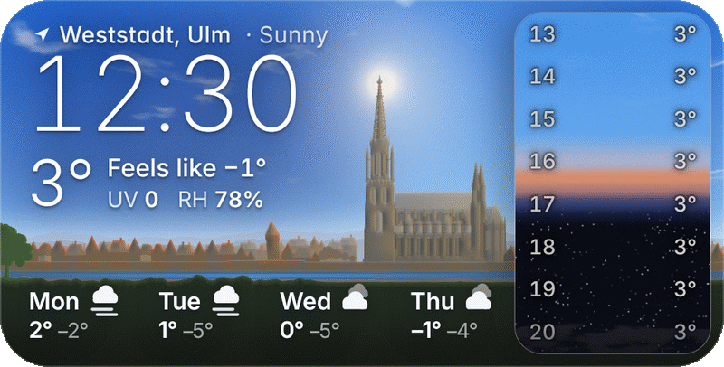
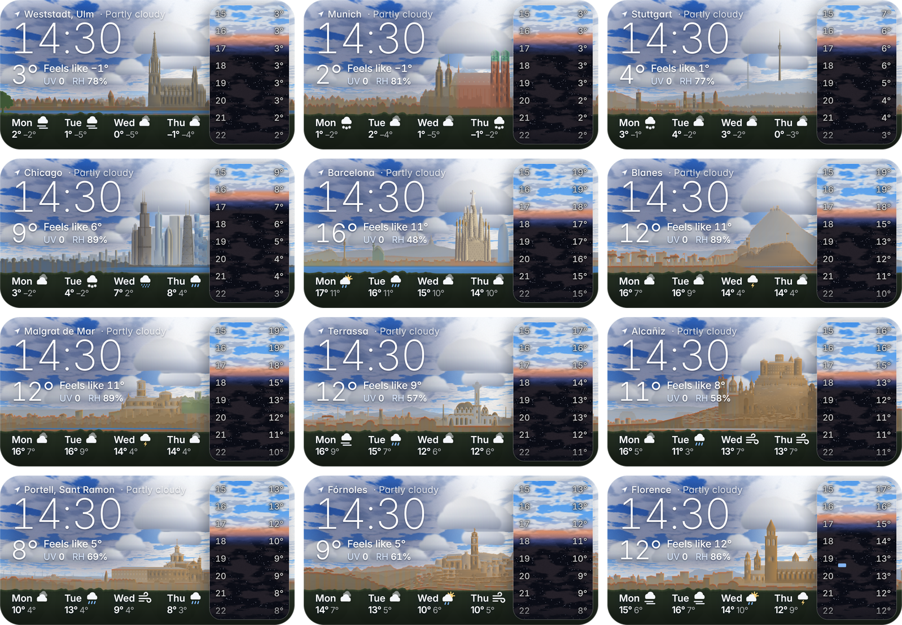
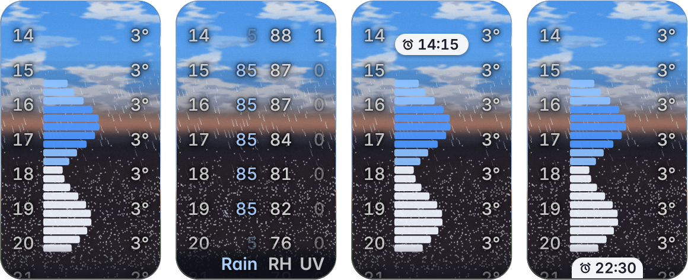

<p align="center"></p>

# Living Sky

An Android home-screen widget that shows your city's skyline under the sky you have right now.

- **Live sky.** The sun and moon in their real positions, plus clouds, rain, snow, fog, storms and sunsets.
- **Your skyline.** 11 hand-drawn cities. Anywhere else, one is drawn automatically from OpenStreetMap.
- **72-hour timeline.** Temperature and rain for each hour. Tap it for rain chance, humidity and UV.
- **Next alarm.** Shown in the timeline.
- **No account and no API key.** Weather comes from [Open-Meteo](https://open-meteo.com).

## Skylines



The 11 hand-drawn skylines were made by **Claude Opus 5.5**, one AI agent per city. Florence (last) is automatic.

## Timeline



Rain bars · tap for rain %, humidity, UV · next alarm · alarm in 8–12 h

## Install

1. Download `living-sky.apk` from [Releases](../../releases/latest) and install it (Android 12+; tested on a Galaxy S23).
2. Add the widget: long-press the home screen → Widgets → **Living Sky**, size 5×2.
3. Settings → Apps → Living Sky → Permissions → Location → **Allow all the time**.
4. Optional: Settings → Apps → Living Sky → **Alarms & reminders** → Allow, so updates land on time.

Tap the sky to refresh, the clock to open your alarms, the timeline to switch values.

## Build

Needs JDK 17+ and the Android SDK (build-tools 35, platform 36). No Gradle.

```sh
./build.sh            # → build/living-sky.apk
./build.sh install    # build and install on the phone connected over adb
```

More in [docs/DEVELOPMENT.md](docs/DEVELOPMENT.md).

## Add your city

Put three files in [`assets/skylines/`](assets/skylines) and rebuild:

```
<id>.json          name, lat, lon, radius_km
<id>_day.svg       379.4 × 192.4, horizon at y = 134
<id>_night.svg     same, with the lights on
```

Rules and checks: [docs/SKYLINES.md](docs/SKYLINES.md). The easiest way is to give that page to an AI model, with an existing
city as the example.

## Credits

Weather data by [Open-Meteo](https://open-meteo.com) (CC BY 4.0). Map data © [OpenStreetMap](https://www.openstreetmap.org/copyright)
contributors. [AndroidSVG](https://bigbadaboom.github.io/androidsvg/) (Apache 2.0). [Inter](https://rsms.me/inter/) font (OFL).

MIT License.
