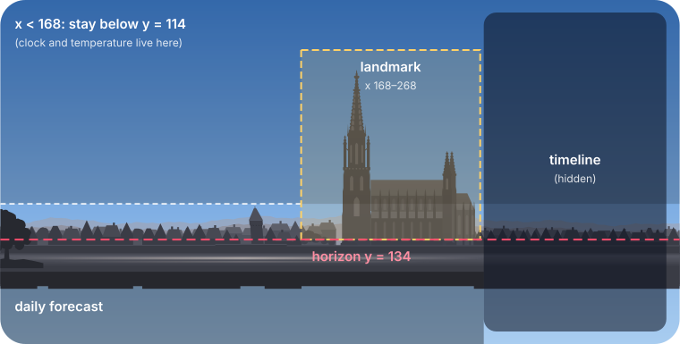

# Add a skyline

A city is three files in [`assets/skylines/`](../assets/skylines):

| File | What |
|---|---|
| `<id>.json` | Where it applies |
| `<id>_day.svg` | The skyline by day |
| `<id>_night.svg` | The same at night: lit windows, floodlit landmarks |

Rebuild (`./build.sh install`). The widget picks the nearest city within its `radius_km`. Everywhere else it draws one
automatically from OpenStreetMap.

## JSON

```json
{
  "id": "ulm",
  "name": "Ulm",
  "country": "DE",
  "lat": 48.3984,
  "lon": 9.9916,
  "radius_km": 15
}
```

Optional:
- `daylight`: colour hints for the day look (`palette`: `alpine`, `med` or `steel`; `hero`: the landmark's x range).
- `view` and `landmarks`: notes for whoever draws the next version.

See [`barcelona.json`](../assets/skylines/barcelona.json) for a full example.

## SVG



- **Canvas:** `viewBox="0 0 379.4 192.4"`, the whole widget. The horizon is at **y = 134**.
- **Landmark:** the tallest thing goes in **x 168–268**, between the text and the timeline.
- **Left side (x < 168):** stays low, below y = 114. Small overlaps with the clock or temperature are fine.
- **Right side (x > 270):** hidden behind the timeline.
- **Below the horizon:** water or ground down to about y = 162. The daily forecast sits on top of it.
- **Heights above the horizon, roughly:**

  | Kind | Height | Examples |
  |---|---|---|
  | Giant | 85–100 | Ulm Minster, Sagrada Família |
  | Big-city landmark | 65–80 | Frauenkirche, Stuttgart TV tower |
  | Town landmark | 45–60 | Village church, Sa Palomera |

- **Allowed:** `path`, `rect`, `circle`, `ellipse`, `g`, and linear or radial gradients.
- **Not allowed:** CSS, `filter`, `mask`, `use` or `text`. The widget draws with [AndroidSVG](https://bigbadaboom.github.io/androidsvg/).
- **Avoid:**
  - floating buildings: everything stands on the ground;
  - large pale flat shapes, which glow on dark skies.

## Check it

Render it on your phone in sun, overcast and night:

```sh
adb shell am broadcast -a dev.livingsky.DEBUG -n dev.livingsky/.DebugReceiver \
  --es place <id> --es scenario clear --es mode day --es cmd render   # then: overcast, and --es mode night
```

Back to live data: `--ez reset true --es place live --es scenario none --es mode auto --es cmd render`.
`tools/verify_skylines.sh` renders every city by day and at night into `build/shots/`.

## Tip

Every current skyline was drawn by **Claude Opus 5.5**, one agent per city. Give an AI model this page plus an
existing city (JSON and both SVGs) as an example, and ask it for yours.
